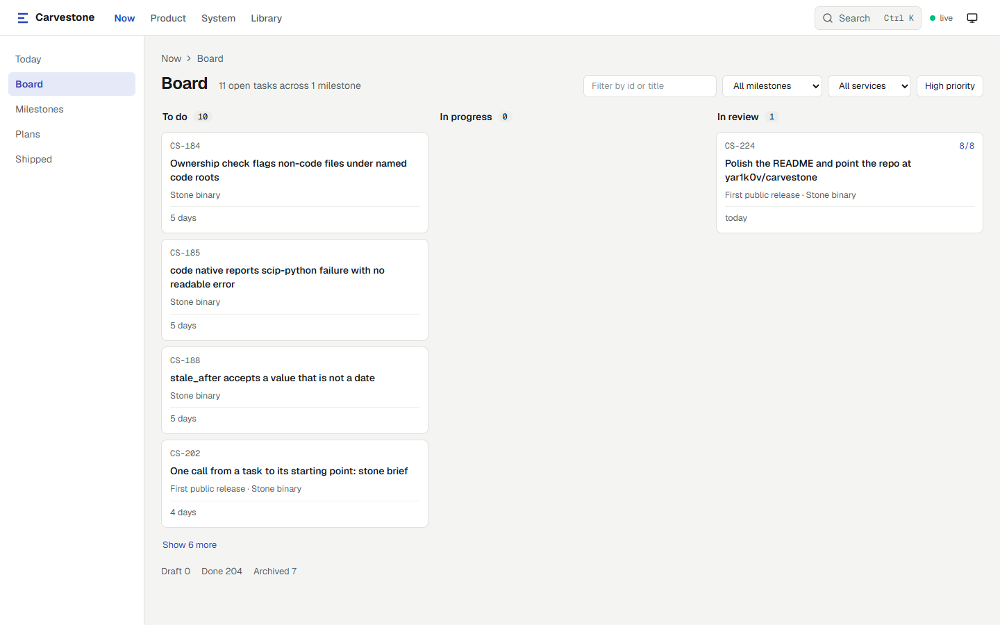
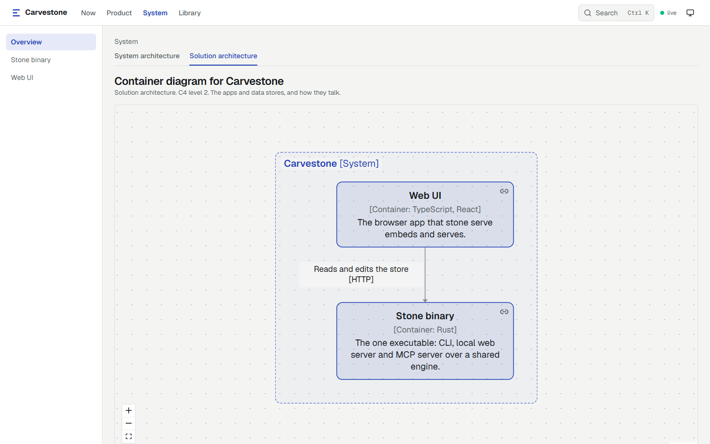

<div align="center">
  

  # Carvestone

  Your project's plan, docs, architecture and code graph, linked in one git repo, for people and AI agents.
</div>

[](https://github.com/yar1k0v/carvestone/actions/workflows/ci.yml)
[](https://github.com/yar1k0v/carvestone/releases)
[](#license)

The CLI is `stone`. Tasks, docs and architecture are markdown files in your repo. The code graph is derived from your source and kept out of git.





## What you get

| Part | What it holds |
| --- | --- |
| Planner | Tasks, a board, milestones, plans and decisions |
| Docs site | Project docs, served as a site with backlinks and Mermaid |
| Architecture | Systems, containers and components that own code, drawn as C4 |
| Code graph | Symbols, dependencies, modules, impact and paths |

The claim is the links between the parts. A task points at a code symbol, a doc shows the component it describes, and a commit names the task and decision behind it.

| Command | Answers |
| --- | --- |
| `stone why <path>[:line]` | Which commits, tasks, plans and decisions stand behind this code |
| `stone history <id>` | How an item changed, with diffs |
| `stone timeline` | What was done, decided and changed, newest first |
| `stone precedents <id>` | Which finished tasks made the same kind of change |
| `stone code impact <symbol>` | What may break, with the open tasks and docs on it |

Commit trailers (`Refs: CS-12`, `Plan: plans/x`, `Decision: ADR-7`) tie commits to items. `stone commit-msg` prints them.

## Install

### Download

The [Releases page](https://github.com/yar1k0v/carvestone/releases) holds `stone-linux`, `stone-macos` and `stone-windows.exe`.

1. Rename the file to `stone` (`stone.exe` on Windows).
2. Put it on `PATH`.
3. On Linux and macOS, run `chmod +x stone`.

It is a single binary, works offline and needs no account.

### Build from source

You need Rust 1.89 and Node with pnpm.

```bash
git clone https://github.com/yar1k0v/carvestone
cd carvestone
pnpm --dir web install
pnpm --dir web build
cargo install --path crates/cli --features ui
```

⚠ Build `web/` first. The `ui` feature embeds `web/dist` in the binary.

## First run

Run these in the repo you want to track.

```bash
stone init --prefix TASK
stone config add-code-root .
stone new task --title "Try stone"
stone serve
```

- `stone init` creates the `stone/` folder and `stone/config.yml`.
- `stone config add-code-root <path>` lists the folders to index. `.` means the whole repo.
- `stone serve` serves the site at `http://127.0.0.1:4747` and watches files for changes. Add `--open` to open it in a browser.
- `stone check` validates the store. Run it in CI.

### For agents

`stone instructions` prints the workflow guide. `stone instructions --write` adds it to `CLAUDE.md` or `AGENTS.md`.

`stone init` offers a Claude Code SessionStart hook that prints `stone map` at the start of each session; `stone map --install-hook` adds it later.

| Topic | Use |
| --- | --- |
| `overview` | Default. What stone is and how to ask it |
| `plan` | Plan a task |
| `do` | Do a task |
| `finish` | Finish a task |
| `debug` | Find a cause |
| `design` | Write and check the architecture |

Agents use the CLI. `stone mcp` is an opt-in read-only MCP server for clients that cannot run a shell.

## Languages

C#, Python, TypeScript/JavaScript, Rust and Dart work with no setup.

For any other language with a SCIP indexer, run the indexer yourself, then list its output file:

```bash
stone config add-scip-index .scip/java.scip --language java --extensions java,kt
```

For a language with no parser, the SCIP index creates the files and symbols.

⚠ Config holds data only. It never runs a command, so a cloned repo cannot run code on your machine.

⚠ Go is proven on a small module only. Other SCIP languages are untested.

`stone code native` adds exact edges for the five built-in languages, from their SDK indexers on `PATH`.

## Architecture

Stone draws C4 levels 1 to 3 from the architecture items in `stone/arch/`. Agents write data, never layout.

- `stone arch connect` writes one connection: from, to, what it does, and a protocol.
- `stone arch gaps` lists what the design lacks, each with the command that fixes it.
- `stone arch c4` prints a diagram as Mermaid text.
- `stone arch hld` and `stone arch lld <container>` print the design.
- `stone arch map` and `stone scan` propose code folders and draft components for an empty map.

⚠ A new project starts with an empty map. Stone checks only the links the build proves: imports, shared libraries and project references. It never calls a written run-time connection wrong.

## Example

The `stone` folder in this repo is a live store. It holds the tasks, decisions and design of Carvestone itself.

```bash
stone list
stone arch hld
stone search "scip"
```

## Development

Full checks:

```bash
cargo fmt --all --check
cargo clippy --workspace --all-targets -- -D warnings
cargo test --workspace
target/debug/stone check
```

When `web/` changed, also run:

```bash
pnpm --dir web typecheck
pnpm --dir web lint
pnpm --dir web test
pnpm --dir web build
```

### Claude Code

The repo ships its Claude Code setup in `.claude/` and `CLAUDE.md`. Setup steps: [docs/contributing-with-claude.md](docs/contributing-with-claude.md).

### Releases

`scripts/build.sh [patch|minor|major]` builds the release binary with the UI into `build/`. With an argument it first bumps the version in `Cargo.toml`. It never commits or tags.

`stone --version` names the commit, for example `stone 0.1.0+<commit>`. A `.dirty` suffix means the tree had uncommitted changes.

To release, commit the bump, then push the tag `v<version>`. The release workflow fails when the tag and `Cargo.toml` differ.

The binaries appear on the [Releases page](https://github.com/yar1k0v/carvestone/releases).

## License

Dual-licensed under [MIT](LICENSE-MIT) or [Apache-2.0](LICENSE-APACHE), at your option.
